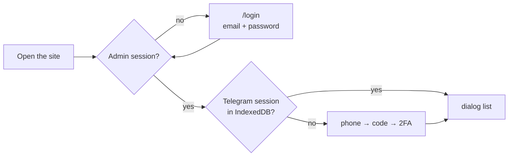
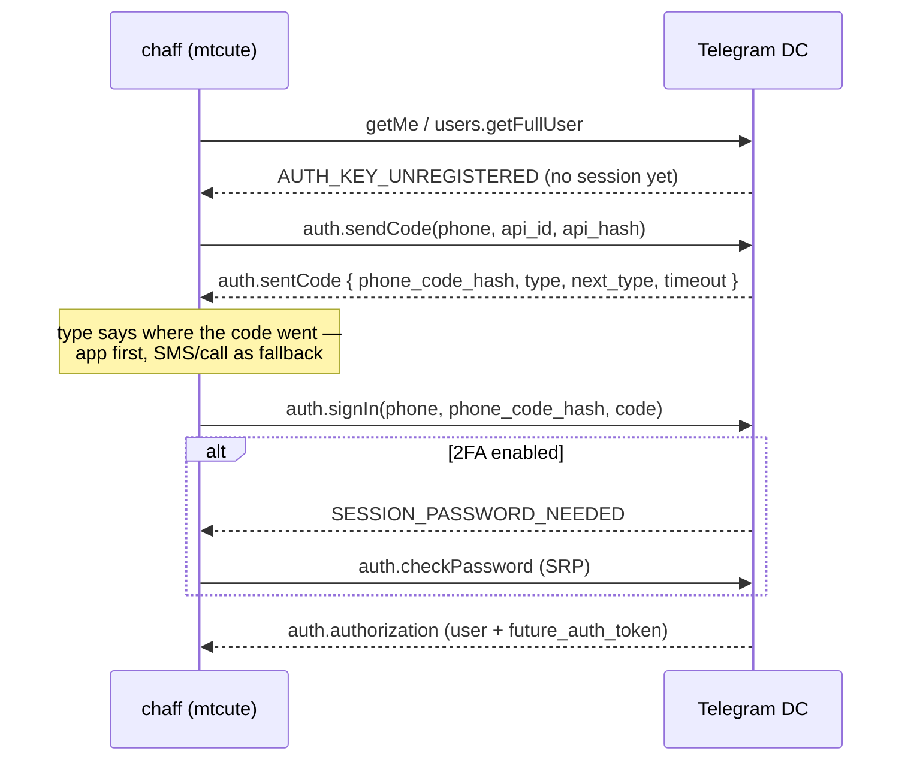

# Telegram setup — credentials, login, and the browser client

Everything chaff-tg does with Telegram starts with one pair of values: an `api_id` and an
`api_hash` that **you** create. There is no shared credential, on purpose. This document is
the single place that explains how to get them, where each front end reads them from, what
the login actually does on the wire, and how to read the `[tg]` console trace when nothing
seems to be sent.

- CLI setup lives in the root [README](../README.md#setup); the web app's environment table
  lives in [web/AGENTS.md](../web/AGENTS.md#environment). This file is the longer story.

## In one screen

| Step | What to do                                                                        |
| ---- | --------------------------------------------------------------------------------- |
| 1    | Create an app at [my.telegram.org/apps](https://my.telegram.org/apps)             |
| 2    | Copy **App api_id** (a number) and **App api_hash** (32 hex characters)           |
| 3    | CLI: `cp web/.env.example .env`, fill both, then `chaff login`                    |
| 4    | Web: fill `web/.env`, then **rebuild** (`bun run build`) — the values are inlined |
| 5    | Read the `[tg]` lines in the DevTools console if the code never arrives           |

## 1. Create your own `api_id`

Sign in at [my.telegram.org/apps](https://my.telegram.org/apps) with the phone number of the
account you will actually use. The code arrives in your Telegram app. Choose **API
development tools** and submit the form — nothing is reviewed, and the credentials appear
immediately.

| Field           | What to put there                                                                               |
| --------------- | ----------------------------------------------------------------------------------------------- |
| **App title**   | Anything honest, e.g. `chaff-tg`.                                                               |
| **Short name**  | 5–32 characters, letters and digits only. `chafftg` works; spaces, hyphens, underscores do not. |
| **URL**         | Blank. Optional, and nothing reads it.                                                          |
| **Platform**    | **Desktop**. A label in your app list; it does not change the credentials.                      |
| **Description** | One plain line, e.g. `A local tool that reviews my chats and leaves the ones I confirm.`        |

### The rules that actually bite

- **One `api_id` per phone number.** Telegram enforces this ([obtaining an
  api_id](https://core.telegram.org/api/obtaining_api_id)): if the number already has an
  app, the form refuses a second one. Any existing id works for any account — the id
  identifies the _application_, not the account it logs in.
- **`api_hash` cannot be revoked.** mtcute's own guide warns about this
  ([Signing in](https://mtcute.dev/guide/intro/sign-in)). Treat it like the session file:
  anyone holding it can act as you. It is the one reason `web/.env` is gitignored.
- **Unofficial clients are put under observation.** Telegram says so plainly, next to the
  ban policy, on [Creating your Telegram
  Application](https://core.telegram.org/api/obtaining_api_id#using-the-api-id) — flooding,
  spam and view-count faking are permanent bans. chaff-tg leaves chats because _you_ asked
  it to; that is the use the API terms describe as legitimate
  ([API Terms of Service](https://core.telegram.org/api/terms)).
- **Do not ship Telegram's sample id.** The id inside Telegram's open-source clients is
  server-side limited and returns `API_ID_PUBLISHED_FLOOD`
  ([same page](https://core.telegram.org/api/obtaining_api_id#using-telegrams-open-source-code)).
- **`my.telegram.org` sometimes answers a bare "ERROR".** Known, unexplained, and often
  transient; see the root README's Troubleshooting section for the workarounds.

## 2. Where each front end reads the values

| Front end     | File                             | How it gets there                                                                                                               |
| ------------- | -------------------------------- | ------------------------------------------------------------------------------------------------------------------------------- |
| CLI           | `.env` in the working directory  | Bun loads it; `chaff login` also writes what it resolved into `~/.config/chaff-tg/config.json` (mode `600`)                     |
| CLI (any cwd) | `~/.config/chaff-tg/config.json` | Read by every command, which is what makes `.env` location irrelevant after the first login                                     |
| Web           | `web/.env`                       | `vite.config.ts` inlines `CHAFF_API_ID` / `CHAFF_API_HASH` into the bundle at **build time** (single-user deployment, accepted) |

Two consequences worth internalising:

1. **Editing `web/.env` does nothing until you rebuild.** `define` is not a runtime lookup —
   a dev server has to restart, and a deployed build has to be rebuilt. The app reports this
   honestly: `credentialsPresent` in `web/src/lib/env.ts` is `false` and the Sign-in button
   is disabled with "No Telegram credentials in this build".
2. **The hash is in the shipped JavaScript.** That is a deliberate trade for a single-user
   deployment, and it is why the web build must never be published for other people.

## 3. Two logins, in this order

The web app asks two different questions, and they must not be confused:



| Gate         | Question                             | Who answers                                                                   | Where the state lives          | Lifetime          |
| ------------ | ------------------------------------ | ----------------------------------------------------------------------------- | ------------------------------ | ----------------- |
| **Admin**    | may this person open the deployment? | Better Auth, one account seeded from `CHAFF_APP_EMAIL` / `CHAFF_APP_PASSWORD` | session cookie in the browser  | 7 days by default |
| **Telegram** | whose chats are these?               | Telegram                                                                      | IndexedDB database `chaff-web` | until signed out  |

Why both exist. Without the admin gate, any visitor can drive **their own** Telegram
account through your deployment, and every login attempt they make is charged to your
`api_id`. That is a live risk even for a page nobody is told about. Without the Telegram
gate, the admin would still have to log in to Telegram once per browser, because that
session is never on the server and cannot be copied between machines.

**"Sign out" closes both.** It deletes the IndexedDB database and clears the session
cookie: one is the Telegram account, the other is the door. Leaving either behind means
the next visitor keeps access after you think you have left.

### How the gate is enforced

Two layers, one question:

1. **`web/src/hooks.server.ts`** runs `auth.api.getSession()` for `/` and `/seam` before
   the page is rendered. No session is a `303` to `/login`. This is the layer that decides
   whether the shell is served at all.
2. **`web/src/routes/+page.svelte`** calls `adminSession()` on mount. A redirect only
   covers document loads; this catches a cookie that expired mid-visit, and a client-side
   navigation back to `/` after signing out. While it is checking, nothing from Telegram is
   rendered, so the phone form cannot flash for someone who is not signed in.

`/login` is the only page outside the gate, and it forwards to `/` when a session already
exists.

### Two traps, both measured

- **`trustedOrigins` must be set.** Better Auth validates the `Origin` header of every
  credentialed POST against `trustedOrigins`, which is **empty by default** — a correct
  `baseURL` alone is not enough. Without it `POST /api/auth/sign-in/email` answers
  `{"message":"Invalid origin","code":"INVALID_ORIGIN"}` and the form never succeeds.
  `web/src/lib/server/auth.ts` sets it from `BETTER_AUTH_URL`.
- **`svelteKitHandler` compares origins.** The helper mounts `/api/auth` only when the
  request origin equals `BETTER_AUTH_URL`; when they differ it returns the SPA fallback — a
  404 that looks like a missing route (`web/AGENTS.md`, trap 3). The hook dispatches on
  `pathname.startsWith('/api/auth')` instead, so the mount does not depend on an env var
  being exactly right.

### The admin account

Sign-up is disabled (`disableSignUp: true`), so the single account can only come from
`bun run db:seed`, which reads `CHAFF_APP_EMAIL` / `CHAFF_APP_PASSWORD` from `web/.env` and
creates the user through Better Auth's internal adapter. It is idempotent: if the account
already exists it reports so and changes nothing, which also means **rotating the password
in `.env` and re-seeding does not update an existing account**.

### What the gate does not protect

The gate stops the **page**. It does not hide the **credentials**: the JavaScript bundle is
static and `CHAFF_API_HASH` is inside it, so anyone who can download the bundle can speak
MTProto with that hash from their own client. Treat the deployment as private — Netlify
password protection, a private network, or basic auth in front of it — and treat a leaked
build as a leaked hash.

It also does not share Telegram sessions. Being the admin on your laptop grants your chats
only where that IndexedDB database already exists; a new browser is a new Telegram login.

## 4. What a Telegram login actually is

chaff-tg speaks MTProto as a user client, not the Bot API — the [comparison
table](https://mtcute.dev/guide/intro/mtproto-vs-bot-api) is worth one read if that
distinction is new. The sequence both front ends perform
([User Authorization](https://core.telegram.org/api/auth)):



Four things that follow from the protocol and are easy to get wrong:

- **The code is sent by `auth.sendCode`, and the reply is where the good news lives.** A
  successful call returns `phone_code_hash` — it is _not_ a message saying "sent". The
  client cannot proceed without it, so a stuck login is almost always a `sendCode` that
  never returned.
- **The code arrives in the Telegram app first.** `sentCode.type` is
  `sentCodeTypeApp` whenever the account has an active session; SMS is a fallback and can
  be delayed. `next_type` + `timeout` are what a "resend" button is built from.
- **2FA is a second, separate exchange.** `SESSION_PASSWORD_NEEDED` is not an error to
  retry — it routes to [SRP](https://core.telegram.org/api/srp).
- **`FLOOD_WAIT` is a real answer.** Repeated login attempts earn it. chaff-tg treats it as
  "stop the run", never "retry harder"
  ([errors: 420 FLOOD](https://core.telegram.org/api/errors#420-flood)).

Method reference, if you are reading the raw layer:
[`auth.sendCode`](https://core.telegram.org/method/auth.sendCode) ·
[`auth.signIn`](https://core.telegram.org/method/auth.signIn) ·
[`auth.checkPassword`](https://core.telegram.org/method/auth.checkPassword) ·
[`auth.resendCode`](https://core.telegram.org/method/auth.resendCode).

## 5. The browser is a different client

`web/` runs `@mtcute/web` **in the tab**. MTProto never moves server-side (`web/AGENTS.md`,
"No Telegram on the server") — the only server code is the Better Auth login gate. That
choice brings four browser-specific facts:

| Fact                                                | Why it matters                                                                                                                                                  |
| --------------------------------------------------- | --------------------------------------------------------------------------------------------------------------------------------------------------------------- |
| Session lives in **IndexedDB**                      | The auth key _is_ the account. "Sign out" deletes the database — anything else would leave the account behind                                                   |
| `crypto.subtle` only exists in a **secure context** | `https://` or `http://localhost`. A LAN address over plain `http` fails at client construction with "WebCrypto is not available"                                |
| Crypto is **WASM**, fetched on connect              | The server must serve it as `application/wasm`; Vite dev does, an intercepting proxy may not ([`@mtcute/web`](https://ref.mtcute.dev/modules/_mtcute_web.html)) |
| Transport is **WebSocket**                          | `wss://{pluto,venus,aurora,vesta,flora}.web.telegram.org/apiws`. A network that blocks `wss` looks exactly like "nothing happens"                               |

Storage details for the same package: [Storage](https://mtcute.dev/guide/topics/storage).
Transport details: [Transport](https://mtcute.dev/guide/topics/transport).

That is also why the **login gate is a separate concern** from the Telegram session: Better
Auth decides who may open the page; Telegram decides what that page can do. Confusing the
two leads to people expecting "sign out" to revoke a Telegram session it never touched.

## 6. Reading the `[tg]` trace

Every Telegram-touching step prints one line through `web/src/lib/log.ts`. The shape is
always:

```
[tg] #12 1.204s signin › Telegram accepted sendCode — waiting for the login code
 ^     ^    ^        ^        ^
 seq   ms   scope    message
```

| Scope     | What it covers                                                      |
| --------- | ------------------------------------------------------------------- |
| `boot`    | trace installed, switches in effect                                 |
| `env`     | secure context, WebCrypto, IndexedDB, online state, worker support  |
| `auth`    | the admin gate: session checks, sign-in, sign-out                   |
| `login`   | the `/login` form                                                   |
| `form`    | button clicks and form submits on the Telegram screen               |
| `session` | phase changes, dialog counts, the leave loop, sign-out              |
| `client`  | client construction, close                                          |
| `signin`  | `start()`, each prompt, `sendCode`, `signIn`, 2FA, failure          |
| `dialogs` | `iterDialogs` start, finish, and the record/skip counts             |
| `me`      | `getMe`                                                             |
| `leave`   | each `leaveChat`                                                    |
| `window`  | uncaught errors and unhandled promise rejections                    |
| `mtcute`  | the library's own lines, re-tagged (`[tg] mtcute info [network] …`) |

The gate comes first, so a fresh browser starts with `auth` lines, not `signin` ones.
Measured, including one rejected attempt:

```
[tg] #1  boot › trace installed — window.__tg.lines() returns this log { verbose: false, enabled: true }
[tg] #2  auth › no admin session — the site gate is closed
         → /login
[tg] #3  login › form submitted { email: 'admin@svelte-apps.me' }
[tg] #4  auth › admin sign-in attempt { email: 'admin@svelte-apps.me' }
[tg] #5  auth › FAILED admin sign-in rejected — Invalid email or password
[tg] #6  login › form submitted { email: 'admin@svelte-apps.me' }
[tg] #7  auth › admin sign-in attempt { email: 'admin@svelte-apps.me' }
[tg] #8  auth › admin signed in — opening the site gate
[tg] #10 auth › admin session present { email: 'admin@svelte-apps.me' }
         → /
```

`Invalid email or password` is the only answer Better Auth gives for a wrong email _and_ a
wrong password — sign-up is disabled, so the two cases are deliberately indistinguishable.

A healthy first login reads, in order (measured against a real account from a headless
Chrome, trimmed to the interesting lines):

```
[tg] #1  boot › trace installed — window.__tg.lines() returns this log { verbose: false, enabled: true }
[tg] #2  form › Sign in with Telegram clicked { credentialsReady: true }
[tg] #4  signin › begin { apiId: 31742529, apiHash: 'len=32' }
[tg] #5  env › browser capabilities { url, secureContext: true, webCrypto: true, indexedDb: true, online: true }
[tg] #8  signin › start(): reading the account first, prompting only if it fails
[tg] mtcute signin info [conn] [DC 2] no perm auth key, authorizing...
[tg] mtcute signin info [auth] [DC 2] authorization successful
[tg] #9  signin › phone: waiting for the form
[tg] #13 signin › phone: answered { value: '+234••••••098' }
[tg] #14 signin › Telegram accepted sendCode — waiting for the login code
[tg] #15 signin › code: waiting for the form
[tg] #17 signin › code: answered { value: '•••••' }
[tg] #19 signin › authorized { id: …, username: … }
```

The two `mtcute` lines between `#8` and `#9` are the handshake actually happening. When
someone says "nothing is sent", those two lines are what separates "we never left the
browser" from "Telegram answered".

### Switches

| Want                                   | Do                                                                   |
| -------------------------------------- | -------------------------------------------------------------------- |
| Silence our lines                      | `localStorage.TG_TRACE = 'off'`, then reload                         |
| mtcute's VERBOSE (MTProto round trips) | `localStorage.TG_TRACE = 'verbose'`, or open the app with `?tgdebug` |
| Keep the log as text                   | `copy(window.__tg.lines())` in the console                           |
| Reset it                               | `window.__tg.clear()`                                                |
| mtcute's level only                    | `localStorage.MTCUTE_LOG_LEVEL = '5'` before load (0–5: off…verbose) |

The trace is scoped to the browser. **No secret reaches a line**: the api hash prints as
`len=32`, the phone number masked, codes and the 2FA password as bullet counts.

## 7. "It doesn't send" — symptom to cause

Read the console before reading the code. The first missing line names the layer.

| What you see                                                            | What it means                                                                                                   |
| ----------------------------------------------------------------------- | --------------------------------------------------------------------------------------------------------------- |
| Sent straight to `/login`, no `boot` line                               | The server gate ran before the page: expected for an anonymous visit                                            |
| `auth › FAILED admin sign-in rejected — Invalid email or password`      | Wrong credentials, or `db:seed` was never run against this database                                             |
| `auth › FAILED admin sign-in rejected` with `Invalid origin`            | `trustedOrigins` does not include the origin you are on. See section 3                                          |
| `/api/auth/*` answers 404 with the SPA shell                            | The mount is by path prefix; if this appears, the hook was replaced — `svelteKitHandler` does an origin check   |
| No `[tg]` line at all, not even `boot`                                  | The module never ran: stale build, wrong tab, or `TG_TRACE` still `'off'`                                       |
| `env › browser capabilities { secureContext: false, webCrypto: false }` | You are on a LAN IP over `http`. Open `http://localhost:5173` or serve over `https`                             |
| `client › FAILED import or construction`                                | WASM blocks, or `crypto.subtle` is missing (see the row above)                                                  |
| `signin › … start() rejected` with a network/socket error               | `wss://…web.telegram.org/apiws` is blocked. Try another network before touching code                            |
| `API_ID_INVALID` / `API_ID_PUBLISHED_FLOOD`                             | Id and hash are not a pair, or you used Telegram's sample id                                                    |
| `PHONE_NUMBER_INVALID`                                                  | Not E.164. `+234…`, no spaces — the form accepts what you type                                                  |
| `PHONE_CODE_INVALID` repeatedly                                         | `phone_code_hash` is stale: restart the login rather than re-entering                                           |
| `sendCode` returned, no message arrives                                 | Check the Telegram app on another device first; SMS is the fallback and can lag. `next_type` is the resend path |
| `FLOOD`                                                                 | Stop. Wait the stated time. The trace prints the message verbatim                                               |
| `SESSION_PASSWORD_NEEDED` then nothing                                  | 2FA: the password prompt is the next form. A wrong password loops on purpose                                    |
| UI stuck on "Connecting…", trace stops mid-flow                         | Look for a `window › unhandled promise rejection` line — an unawaited transport failure is the usual culprit    |

### The one that looks like a bug in this repo

Measured on a real build, with a deliberately invalid number so no code could be
delivered:

```
[tg] #13 signin › phone: answered { value: '+999•••••999' }
[tg] #14 signin › FAILED start() rejected — nothing was sent or nothing came back
              — Error: Telegram API error 420: FLOOD_WAIT_21697
    at auth.sendCode
    at async sendCode (…/@mtcute_web.js)
    at async start (…/@mtcute_web.js)
```

That is the whole answer to "the code doesn't send": **Telegram refused the request**. The
request left the browser, reached DC 2, and came back as
[`FLOOD_WAIT_21697`](https://core.telegram.org/api/errors#420-flood) — 21 697 seconds, about
six hours. Nothing is wrong with the client; it is being throttled for repeated login
attempts on that account.

The form now says so in words instead of a toast that expires: "Telegram is rate-limiting
sign-in (…FLOOD_WAIT_21697). Nothing was sent. Wait about 6 hours; retrying before then only
repeats this error."

The window is fixed, not extended by a rejected attempt — measured across two runs roughly
100 seconds apart, the same flood reported `21697` and then `21597`. It counts down on its
own, and nothing in this app can shorten it. Repeated attempts are what earned it in the
first place, so the correct response is to leave the account alone until it clears.

## 8. Checklist before you ship a build

- [ ] `CHAFF_API_HASH` is **not** in git — `web/.env` is gitignored, `web/.env.example` holds placeholders only.
- [ ] The build was made **after** the last `.env` edit; `credentialsPresent` is `true` in the UI.
- [ ] `BETTER_AUTH_URL` and `trustedOrigins` name the deployed origin exactly (`https://…`, no trailing slash).
- [ ] The admin gate was tested in a private window: `/` redirects to `/login`, and a wrong password stays there.
- [ ] The dev server runs on the port named in `BETTER_AUTH_URL`, or `/api/auth/*` 404s.
- [ ] One account only: sign-up is disabled, `db:seed` created the single user.
- [ ] "Sign out" was tested and the next visit asks for the admin password and then the phone (IndexedDB really was deleted, and so was the cookie).
- [ ] The deployment is private. The api hash ships inside the JavaScript, so the gate is not a credential boundary.

## References

Telegram:

- [Creating your Telegram Application](https://core.telegram.org/api/obtaining_api_id) — the api_id rules, the observation/ban policy
- [API Terms of Service](https://core.telegram.org/api/terms)
- [User Authorization](https://core.telegram.org/api/auth) — `sendCode` → `sentCode` → `signIn`
- [`auth.sendCode`](https://core.telegram.org/method/auth.sendCode) · [`auth.signIn`](https://core.telegram.org/method/auth.signIn) · [`auth.checkPassword`](https://core.telegram.org/method/auth.checkPassword)
- [Two-factor authentication (SRP)](https://core.telegram.org/api/srp)
- [Errors](https://core.telegram.org/api/errors) — including `FLOOD_WAIT`
- [QR login](https://core.telegram.org/api/qr-login) and [passkeys](https://core.telegram.org/api/passkeys) — the alternative flows mtcute also supports

mtcute:

- [Signing in](https://mtcute.dev/guide/intro/sign-in) — api keys, `start()`, QR, bots
- [Quick start](https://mtcute.dev/guide/) · [FAQ](https://mtcute.dev/guide/intro/faq) · [Errors](https://mtcute.dev/guide/intro/errors)
- [Storage](https://mtcute.dev/guide/topics/storage) · [Transport](https://mtcute.dev/guide/topics/transport)
- [`@mtcute/web` API reference](https://ref.mtcute.dev/modules/_mtcute_web.html) — WASM crypto, WebSocket transport, IndexedDB storage

In this repo:

- [README → Setup](../README.md#setup) — the CLI path, field by field
- [web/AGENTS.md](../web/AGENTS.md#environment) — which variable reaches the bundle and which reaches the server
- [web/src/lib/telegram.ts](../web/src/lib/telegram.ts) — the only mtcute importer in `web/`
- [web/src/lib/log.ts](../web/src/lib/log.ts) — the trace described in section 6
- [web/src/hooks.server.ts](../web/src/hooks.server.ts) — the server half of the admin gate
- [web/src/lib/auth-client.ts](../web/src/lib/auth-client.ts) — the browser half
